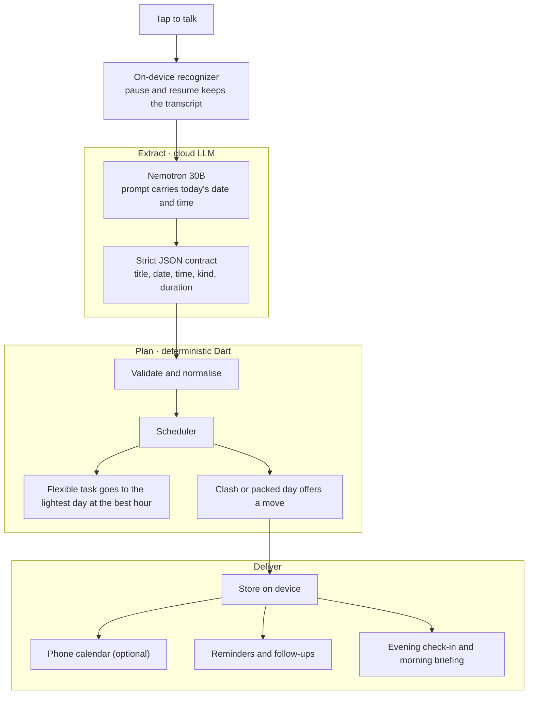

<div align="center">

# Voice Tasks

**I need it, so I build it.**

**Voice-first task planner for Android.**

Speak a messy sentence; the app turns it into clean, scheduled tasks, drops
them into your calendar, and follows up like a person.

[](https://flutter.dev)
[](#requirements)
[](LICENSE)

</div>

---

## Why

I kept capturing to-dos in scattered notes and forgetting the *when*. Every
existing app expected me to type, tap a date picker, choose a time, pick a
category. So I built the app I wanted: **say it, and it just works it out.**

> "today I want to play and go to the store and tomorrow I'll clean the house and study"
> → 4 tasks: two today, two tomorrow.

## Features

| | |
|---|---|
| 🎙️ **Tap-to-talk capture** | One button. Tap to start, tap to stop. The transcript survives pauses instead of restarting. |
| 🧠 **Full extraction, not just transcription** | An LLM splits the sentence into tasks and resolves each one's **day, clock time, kind and duration** — including multi-day sentences. |
| 🗓️ **Smart scheduling** | Flexible tasks land on your lightest day at your best hour. Overlaps and packed days get a friendly *"Move it to Friday at 6 pm?"* prompt. |
| ⏰ **Human reminders** | A nudge at the right time, a follow-up 45 min later with **Done / Later / Drop**. After three postponements it asks if the task should be made smaller. |
| 📅 **Phone calendar** | Writes events to the device calendar (optional switch). |
| 🌙 **Evening check-in** | Speaks *"How did today go?"* and understands *"I did the invoice but didn't call the dentist."* |
| ☀️ **Morning briefing** | Reads your day aloud with the phone's text-to-speech. |
| 📓 **Voice diary** | Talk freely; only the sentences that express intent become tasks. |
| 🔥 **Streaks & patterns** | Streak counter and learned habits (*"you finish most tasks before noon"*). |
| ⚡ **Fast capture** | Long-press the app icon → **Record a task**. |

## How it works



The model receives **today's date and the current time**, so relative phrases
("tomorrow", "next week", "at 6pm") resolve against the real calendar. It
replies in a strict JSON contract:

```json
{
  "tasks": [
    {"title": "Call mom", "date": "2026-10-15", "time": "17:00", "kind": "fixed",    "duration": 15, "unsure": false},
    {"title": "Study",    "date": null,          "time": null,   "kind": "flexible", "duration": 45, "unsure": false}
  ]
}
```

| field | type | meaning |
|---|---|---|
| `title` | string | short imperative ("Call mom") |
| `date` | `YYYY-MM-DD` or `null` | resolved from today; `null` when the day is vague ("this week") |
| `time` | `HH:MM` or `null` | 24-hour clock, or `null` |
| `kind` | `fixed` / `deadline` / `flexible` | specific time / before-by-until / no date and no time |
| `duration` | int | estimated minutes |
| `unsure` | bool | true when the day is genuinely ambiguous |

The reply is **validated and normalised** in Dart before it reaches the UI — a
time with no day becomes today (or tomorrow once it has passed), a dated task is
never left `flexible`, and a `deadline` only survives if the sentence actually
said *before / by / until*. A bad generation can never produce a malformed task.
See [`lib/services/ai.dart`](lib/services/ai.dart) for the prompt and the
contract.

Everything after extraction — placement, conflicts, reminders, check-in,
streaks — is plain, deterministic Dart. No black boxes where correctness
matters.

## Requirements

- Flutter **3.44+** (Dart 3.3+)
- Android device or emulator with Google speech services
- An API key for an OpenAI-compatible endpoint (the default is
  [NVIDIA NIM](https://build.nvidia.com) — a key is created in a couple of minutes)

## Getting started

```bash
git clone https://github.com/EngSenku/voice-tasks.git
cd voice-tasks

# The key is never committed. Pass it at build time:
flutter run --dart-define=NVIDIA_API_KEY=nvapi-your-key-here
```

Or paste the key into the app: **AI settings** (tap the status line under the
mic) → *API key*. It is stored in `shared_preferences` on the device and can be
changed or rotated at any time.

### Release build

```bash
flutter build apk --release --split-per-abi \
  --dart-define=NVIDIA_API_KEY=nvapi-your-key-here
```

Install with:

```bash
adb install -r build/app/outputs/flutter-apk/app-arm64-v8a-release.apk
```

## Configuration

| Setting | Default | Where |
|---|---|---|
| API key | *(empty)* | `--dart-define=NVIDIA_API_KEY=…` or **AI settings** |
| Model | `nvidia/nemotron-3.5-lightning-30b-a3b` | **AI settings** |
| Base URL | `https://integrate.api.nvidia.com/v1` | **AI settings** |

`String.fromEnvironment('NVIDIA_API_KEY')` keeps credentials out of the source
tree entirely — the app ships with an empty default and asks for a key.

## Privacy & security

- **No backend, no account.** Tasks are stored on the phone only.
- Voice is transcribed **on the device** by the system recognizer; only the
  resulting **text** is sent to the model to be structured.
- No API key is hard-coded in this repository. Supply it at build time or enter
  it on the device.

## Project structure

```
lib/
├── main.dart                 # entry point, quick actions, notification wiring
├── models/task.dart          # Task model, enums, date helpers
├── theme.dart                # dark "glass" theme
├── screens/                  # home, review, calendar, check-in
├── services/
│   ├── ai.dart               # ✦ prompt + JSON contract + normalisation
│   ├── cloud_ai.dart         # NVIDIA NIM client
│   ├── speech.dart           # recognizer with pause/resume merge
│   ├── scheduler.dart        # slot finding, conflicts, packing
│   ├── store.dart            # persistence + notification scheduling
│   ├── notifier.dart         # reminders, repeats, follow-ups
│   ├── calendar_sync.dart    # device calendar bridge
│   ├── checkin.dart          # "what did you actually finish?" parsing
│   ├── insights.dart         # streaks, best hour, briefing text
│   └── quotes.dart           # cached daily quote
└── widgets/                  # glass panels, mic button, quote card
```

## Testing

```bash
flutter analyze
flutter test
```

The suite covers the AI JSON contract and normalisation (dates, times, kinds,
de-duplication) and the speech-transcript merge logic — the two places where a
mistake is most visible to the user.

## Known limits

- English only.
- Reminders use inexact alarms, so they can arrive a few minutes late (this
  avoids Android's special exact-alarm permission).
- Speech quality depends on the phone's recognizer.
- Location reminders ("when I'm near the pharmacy") need geofencing and are not
  included yet.

## License

[MIT](LICENSE) © 2026 Mohamed Abbou
