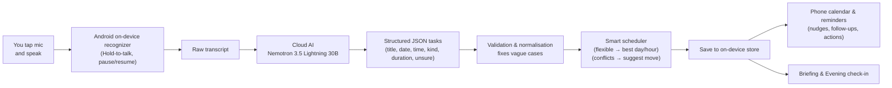

<div align="center">

# Voice Tasks

**I need it, so I build it.**

**Voice-first task planner for Android.**

Speak a messy sentence; the app turns it into clean, scheduled tasks, drops
them into your calendar, and follows up like a person.

[](https://flutter.dev)
[](#requirements)
[](LICENSE)

</div>

---

## Why

I kept capturing to-dos in scattered notes and forgetting the *when*. Every
existing app expected me to type, tap a date picker, choose a time, pick a
category. So I built the app I wanted: **say it, and it just works it out.**

> "today I want to play and go to the store and tomorrow I'll clean the house and study"
> → 4 tasks: two today, two tomorrow.

## Features

| | |
|---|---|
| 🎙️ **Tap-to-talk capture** | One button. Tap to start, tap to stop. The transcript survives pauses instead of restarting. |
| 🧠 **Full extraction, not just transcription** | An LLM splits the sentence into tasks and resolves each one's **day, clock time, kind and duration** — including multi-day sentences. |
| 🗓️ **Smart scheduling** | Flexible tasks land on your lightest day at your best hour. Overlaps and packed days get a friendly *"Move it to Friday at 6 pm?"* prompt. |
| ⏰ **Human reminders** | A nudge at the right time, a follow-up 45 min later with **Done / Later / Drop**. After three postponements it asks if the task should be made smaller. |
| 📅 **Phone calendar** | Writes events to the device calendar (optional switch). |
| 🌙 **Evening check-in** | Speaks *"How did today go?"* and understands *"I did the invoice but didn't call the dentist."* |
| ☀️ **Morning briefing** | Reads your day aloud with the phone's text-to-speech. |
| 📓 **Voice diary** | Talk freely; only the sentences that express intent become tasks. |
| 🔥 **Streaks & patterns** | Streak counter and learned habits (*"you finish most tasks before noon"*). |
| ⚡ **Fast capture** | Long-press the app icon → **Record a task**. |

## How it works



### 1. Capture
You speak; the phone's built-in `speech_to_text` turns it into text. Holding the mic means it keeps going even if you pause (no restart). No audio is uploaded — only the final text.

### 2. Full extraction (AI)
The text goes to **NVIDIA NIM (Nemotron 3.5 Lightning 30B)**. The prompt includes **today's date and the current time** so it can resolve *"tomorrow", "next week", "at 6pm", "before 5"* correctly. It returns a strict JSON array:

```json
{
  "tasks": [
    { "title": "Call mom", "date": "2026-10-15", "time": "17:00", "kind": "fixed", "duration": 15, "unsure": false },
    { "title": "Study",    "date": null,          "time": null,   "kind": "flexible", "duration": 45, "unsure": false }
  ]
}
```

### 3. Validation & normalisation (safety)
Before anything is shown or scheduled, Dart cleans up the model's answer:

- **Time without day** → `today` if that time is still ahead, else `tomorrow`
- **Date present but `kind=flexible`** → becomes `fixed`
- **`kind=deadline` but no limit word (`before/by/until`)** → becomes `fixed`
- **Deadline has a real limit word** → kept as `deadline`
- **Past date** → flagged as `unsure` so you can quickly review
- **Duration** → clamped to a sensible range, duplicates removed

### 4. Planning & scheduling
- **Flexible** (`date=null`) → placed on your **lightest day** at your **best hour**
- **Fixed/Deadline** → checked against existing tasks; if there's an **overlap** or the day is **packed**, the app suggests moving it to an open slot
- **Review screen** → tap any task's mic to re-say it and fix it instantly

### 5. Deliver & remind
Tasks stay on the phone. You can optionally sync to the phone's calendar. The app nudges at the right time, follows up 45 minutes later with **Done / Later / Drop**, and handles the evening check-in and morning briefing.

See [`lib/services/ai.dart`](lib/services/ai.dart) for the full prompt and [`lib/services/cloud_ai.dart`](lib/services/cloud_ai.dart) for the API call.
